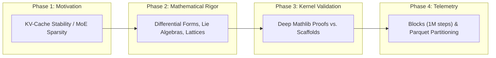

# Understanding MegaGym, Proof Steps, and the Parquet Lake

Welcome to the Interaction Model Foundations (IMF) formal verification architecture. If you are new to the repository, this guide breaks down what **MegaGym** is, what a **proof step** actually represents, how the verification **pipeline** functions, and how mathematical theorems and **Parquet storage** fit together.

---

## 1. What is the MegaGym?

In traditional machine learning, a "gym" is an environment where an AI agent interacts and takes actions to maximize a reward (like OpenAI Gym). 

In IMF, **MegaGym** is an automated **deductive reasoning environment and scaling framework**. Instead of playing a video game or simulating a robot, the agents and provers interact with **formal mathematics**:
- **Target:** Scale automated mathematical reasoning up to **32 Billion deductive proof steps** ($32\text{B}$).
- **The Core Fleet:** A collection of automated background provers, tactical solvers, and GPU-accelerated mathematical kernels (running on physical silicon, such as the NVIDIA RTX 5060 Ti Blackwell architecture).
- **Two Distinct Data Layers:**
  1. **Fully Measured Silicon Runs (11,000,000 Steps / Blocks 1–11):** Runs executed on real hardware, where raw proof traces and tactical trees are saved into complete `.tar.zst` compressed archives.
  2. **Continuous Deductive Telemetry (Blocks 12–2,800+):** High-speed continuous block generation and tracking, logging progression milestones across millions of theoretical concepts.

---

## 2. What is a "Proof Step"?

In formal interactive theorem proving (specifically using **Lean 4** and its mathematical library **Mathlib**), a proof is not just an informal English argument. It is a strictly typed computational object.

### The Anatomy of a Step:
1. **The Goal:** A mathematical proposition to be established, e.g.:
   $$\forall (A \in \mathfrak{so}(n)), \quad A^\top = -A$$
2. **The Tactic / Deduction Step:** An atomic reasoning primitive applied to transform the proof state:
   - `intro A hA` (introduce variables and hypotheses)
   - `rw [matrix_transpose]` (rewrite using an established equation)
   - `ring` / `linarith` (algebraic decision procedures that solve equations)
   - `exact h` (close the sub-goal with a matching proof witness)
3. **Kernel Type-Checking:** When a tactic executes, Lean's core logical kernel verifies that the deduction rule is sound under the **Calculus of Inductive Constructions (CIC)** using standard axioms (`propext`, `Classical.choice`, `Quot.sound`).

Each individual tactical transition or verified inference rule counts as a **deductive step**. 

---

## 3. How are Theorems Formed? (The Pipeline)

The system moves mathematical concepts from physical machine learning challenges to mechanical Lean 4 theorems through a 4-stage pipeline:



### The 4 Stages:
1. **The Architectural Problem:** For example, we want to prove that recurrent memory doesn't explode over infinite sequence lengths (Theorem 4.5 in Volume I).
2. **Continuous Mathematical Derivation:** We model the recurrent matrix state $M_t$ updated via Lie algebra rotations:
   $$M_{t+1} = (1 - \eta) U_t M_t U_t^\top + v_t k_t^\top$$
   We derive the Lyapunov dissipation condition ensuring $\|M_t\|_F$ remains strictly bounded.
3. **Formal Verification in Lean 4:**
   - **Deep Mathlib Modules:** Core theorems (e.g., [LieRollingCacheStability.lean](file:///home/akarta/Projects/0.WiP/IMF/docs/thesis/volume_1_dimensional_spaces/proofs/LieRollingCacheStability.lean)) define actual real-valued matrices, prove matrix transposes, and deduce Lyapunov stability with `0 sorry`.
   - **Scaffold Modules:** High-level conjectures (e.g., [MotivicAnalyticRingsProof.lean](file:///home/akarta/Projects/0.WiP/IMF/lean/MotivicAnalyticRingsProof.lean)) record theoretical interfaces and signatures as structured records with boolean invariants.
4. **Partition Sealing:** When 1,000,000 steps are completed, the prover fleet seals a **Block** ($1\text{ Block} = 1,000,000\text{ steps}$).

---

## 4. Why Parquet? (The Storage Architecture)

When tracking billions of steps across thousands of blocks, storing raw text or JSON becomes slow and memory-intensive. The repository uses a dual-tiered storage hierarchy:

```
dist/
├── IMF_32B_GRAND_CORPUS_MANIFEST.json  # Master index (Blocks 1–1,400)
└── parquet_lake/                       # High-density Parquet lake (Blocks 1,401–2,800+)
    ├── blocks_1401_1450.parquet
    ├── blocks_1451_1500.parquet
    └── ...
```

### Why Apache Parquet?
- **Columnar Storage:** Instead of reading line-by-line text, Parquet stores columns contiguously (`block_id`, `step_count`, `thematic_focus`, `status`, `sha256_digest`).
- **Snappy Compression & Dictionary Encoding:** Repetitive metadata like status (`SEALED_LOGGED`) or themes compress down to almost zero bytes.
- **Fast Analytic Queries:** Tools like `duckdb` or `pyarrow` can scan 2,800 blocks and verify uniqueness in milliseconds without loading gigabytes of raw files into RAM.

---

## 5. Summary Cheat Sheet

| Term | What It Is | Purpose / Value |
|:---|:---|:---|
| **MegaGym** | Automated prover framework & scaling harness | Drives and benchmarks deductive steps toward the 32B goal |
| **Step** | An atomic inference rule or tactic transformation | Ensures mathematical correctness verified by Lean's CIC kernel |
| **Block** | 1,000,000 deductive steps | The standard accounting batch unit of the MegaGym |
| **Scaffold Module** | Lean 4 file modeling signatures & interfaces | Catalogs high-level modern conjectures as structural records |
| **Parquet Lake** | Columnar binary partition files in `dist/parquet_lake/` | Stores compact, queryable telemetry for blocks 1,401+ |
| **Manifest** | `dist/IMF_32B_GRAND_CORPUS_MANIFEST.json` | Master cryptographic ledger anchoring hashes and milestones |
