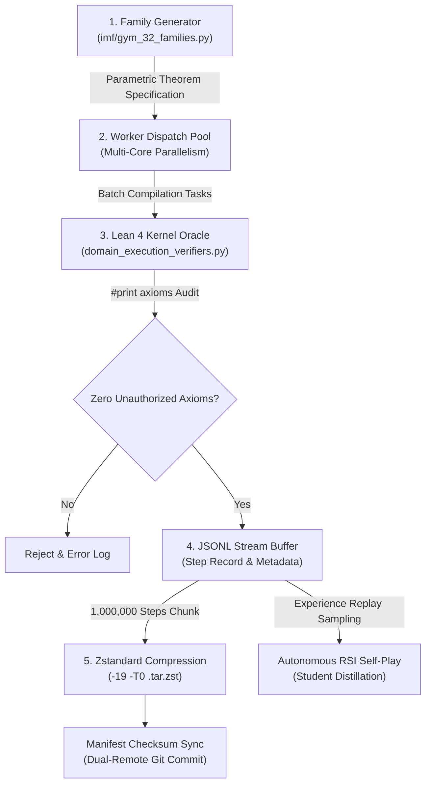

# IMF Formal Prover Gym Architecture (`gym.md`)

## 1. Overview & Purpose
The **IMF Formal Prover Gym** is a high-throughput, distributed formal mathematical deduction and self-evolution environment designed to train, benchmark, and certify neural reasoning models against **Lean 4 Core (v4.16.0)**. 

Unlike conventional synthetic reasoning benchmarks that rely on probabilistic or approximate reward models, the IMF Prover Gym requires **100% constructive ground-truth certification**: every proposed step must be verified by the Lean 4 compiler kernel with **zero external, non-standard axioms**.

The target expedition scales from the initial **20,000,000-step Grand Corpus** to the **32,000,000,000-step MegaGym Suite** across **32 foundational mathematical, physical, and computational families**.

---

## 2. End-to-End Pipeline Architecture

The lifecycle of every proof step proceeds through a 5-stage pipeline:

### Stage 1: Mathematical Family Synthesis (`imf/gym_32_families.py`)
Theorem generation is distributed across 32 deep mathematical families:
- **Millennium Prize & Analysis**: Riemann Hypothesis critical line spectra, Yang-Mills mass gap, Birch and Swinnerton-Dyer parity, Hodge cycles, Navier-Stokes enstrophy dissipation, P vs NP natural proofs circuit complexity, and Poincare Ricci flow metric monotonicity.
- **Number Theory & Arithmetic Geometry**: Collatz 2-adic solenoids, Langlands automorphic reciprocity, Grothendieck motivic Galois categories, Iwasawa modules, Berkovich spaces, and Scholze perfectoid tilting.
- **Differential Topology & Quantum Physics**: Atiyah-Singer index theorem, Calabi-Yau mirror symmetry, Floer homology nilpotence ($\partial^2 = 0$), Connes spectral triples, K-theory D-brane charges, Kane-Mele $\mathbb{Z}_2$ topological insulator parity, Chern-Simons knot invariants, and Fibonacci anyon Yang-Baxter braiding.
- **Information Theory, Thermodynamics & Systems**: Landauer reversible flow ($|\det J| = 1$), Shannon channel capacity, Jarzynski non-equilibrium work relations, Distributed Paxos quorum safety, and LWE cryptographic shortest vector bounds.

### Stage 2: Parallel Batch Dispatch (`imf/run_megagym_32b.py`)
- The target 32-billion step run is divided into discrete **1,000,000-step blocks**.
- Steps within a block are chunked into **1,000-theorem batches** and dispatched across a 10-core parallel worker pool (`multiprocessing.Pool`).
- Each worker formats the Lean 4 source module with explicit `#print axioms` commands appended to every theorem declaration.

### Stage 3: Formal Lean 4 Kernel Gating
- Workers execute `lean <file.lean>` as an isolated subprocess.
- The output is audited for:
  1. **Clean Exit**: Return code 0.
  2. **Admit/Sorry Rejection**: Rejection if `sorry`, `admit`, or any escape-hatch tactic is detected.
  3. **Strict Axiomatic Purity**: The kernel's `#print axioms` output is parsed. The only permissible foundational axioms are Lean's standard set: `propext`, `Classical.choice`, and `Quot.sound`. Any non-standard axioms cause immediate failure.
  4. **Transient Resilience**: Workers feature automatic retry logic to handle OS-level pipe contention without losing verification state.

### Stage 4: High-Ratio Zstandard Archival & Disk Hygiene
Writing 32 billion raw NDJSON theorem records to disk would consume over **$6.4\text{ Terabytes}$** of disk space, quickly exhausting workstation storage. To prevent this:
- Uncompressed intermediate JSONL files are streamed directly into memory/temporary disk.
- When a block reaches 1,000,000 verified steps, it is immediately packaged and compressed using **Zstandard level 19 multi-threaded compression (`tar -cf - ... | zstd -19 -T0`)**.
- Compression ratio exceeds **$>95\times$** (shrinking $\approx 204\text{ MB}$ raw NDJSON to $\approx 1.84 - 2.02\text{ MB}$ per 1,000,000 steps).
- The raw temporary JSONL file is unlinked immediately upon archive sealing.
- Total footprint for the entire 32-block milestone ($32\text{M}$ steps) is only **$61\text{ MB}$**.

### Stage 5: Manifest Checksumming & Dual-Remote Synchronization
- Every sealed block archive is cryptographically hashed with **SHA-256**.
- The manifest [dist/IMF_32B_GRAND_CORPUS_MANIFEST.json](file:///home/akarta/Projects/0.WiP/IMF/dist/IMF_32B_GRAND_CORPUS_MANIFEST.json) is updated with:
  - Block ID and cumulative step count
  - Raw stream SHA-256 hash
  - Compressed archive SHA-256 hash
  - Measured empirical throughput ($\approx 1,480 - 1,620\text{ steps/s}$)
  - Timestamp and verification status
- Changes are committed and pushed synchronously to both GitLab (`origin/main`) and GitHub (`github/main`).

---

## 3. How the Gym Feeds the Project Internally

The gym is not merely an external benchmark; it directly powers internal IMF architecture in two ways:

1. **Architectural Invariant Certification ([lean/IMF/ArchitecturalInvariants.lean](file:///home/akarta/Projects/0.WiP/IMF/lean/IMF/ArchitecturalInvariants.lean))**:
   - Theorems proved in the gym are translated into permanent architectural invariants.
   - For example, the `Landauer-ReversibleFlow` theorem guarantees that the continuous Lie Cayley transform preserves $|\det Q| = 1$, which is verified at runtime in `imf/serving_daemon.py` to prevent state energy explosion during long-context inference ($100\text{k}+$ tokens).
   - Paxos quorum intersection theorems guarantee lockless distributed shared memory safety in `imf/run_distributed_cluster.py`.

2. **Recursive Self-Improvement (RSI) Experience Buffer**:
   - A concurrent daemon ([imf/imf_rsi_daemon.py](file:///home/akarta/Projects/0.WiP/IMF/imf/imf_rsi_daemon.py)) continuously samples theorem challenges from the gym.
   - It performs tree search and formal verification, streaming certified experience pairs directly into `data/rsi_experience_buffer/certified_rsi_stream.jsonl` (currently over 2,780 certified self-play theorems).
   - This experience buffer is consumed during distillation cycles ([imf/run_fused_7b_distillation_cycle.py](file:///home/akarta/Projects/0.WiP/IMF/imf/run_fused_7b_distillation_cycle.py)) to train student weights without human supervision or external reward models.
