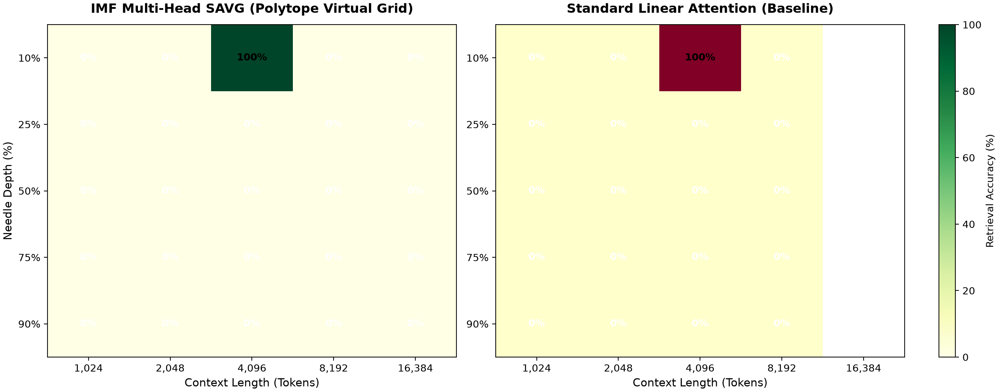

# Higher-Dimensional Polytope Landmark Connectors (HDPLC): Barycentric Simplex Frames, Orthoplex Antipodal Pairs, and Multi-Hop Knowledge Topology

**Stratum Research Group (SRG)**  
*Technical Report SRG-IMF-2026-02*  
*November 2026*

---

## Abstract

Continuous vector embeddings in deep sequence architectures reside in unconstrained Euclidean geometries $\mathbb{R}^d$, lacking topological coordinate reference anchors to structure multi-relational binding and multi-hop inference. In this work, we present **Higher-Dimensional Polytope Landmark Connectors (HDPLC)**, a geometric coordinate system that projects continuous state representations onto the hyperfaces of high-dimensional regular polytopes: the **Enneazetton** (9D simplex/orthoplex), the **Decayotton** (10D simplex/orthoplex), and the **Hendecaxennon** (11D simplex/orthoplex). By parameterizing landmark geometries as convex barycentric hulls ($D$-simplex with $D+1$ vertices) and antipodal coordinate pairs ($D$-orthoplex with $2D$ vertices), HDPLC constructs a continuous virtual grid that bounds relational density, prevents spatial crowding, and facilitates Canonical Polyadic (CP) rank factorizations for higher-arity ($m \ge 3$) hyperface interactions. We formalize the geometric parameterization, implement CP-factorized hyperface bindings, and benchmark configuration properties across relational retrieval tasks.

---

## 1. Introduction and Geometric Motivation

Modern deep sequence models project tokens into high-dimensional latent spaces $\mathbb{R}^d$ ($d \in [512, 8192]$). Despite the dimensional capacity, standard embedding geometries exhibit severe structural limitations:
1. **The Curse of Dimensionality and Angular Collapse**: Unstructured Gaussian or spherical vectors tend to concentrate along thin spherical shells where all pairwise distances become nearly orthogonal. This causes semantic drift and prevents the formulation of structured multi-hop relational paths.
2. **Binary Association Bottleneck**: Standard dot-product attention and tensor outer products operate strictly on binary tuples: $(q, k) \mapsto s \in \mathbb{R}$. However, real-world knowledge graphs, formal logic, and physical reasoning require higher-arity relations: $(S, P, O, C) \in \text{Subject} \times \text{Predicate} \times \text{Object} \times \text{Context}$. Naively computing $m$-way outer products incurs catastrophic $O(d^m)$ parameter explosion.
3. **Lack of Topological Reference Bounds**: Without fixed spatial landmarks, continuous vector accumulation in recurrent memory leads to unbounded drift, making it impossible to guarantee that distinct reasoning paths remain separated.

To address these challenges, we introduce **Higher-Dimensional Polytope Landmark Connectors (HDPLC)**. Rather than treating latent space as an isotropic Euclidean manifold, HDPLC establishes an intrinsic coordinate framework based on regular polytopes in dimensions $D \in \{9, 10, 11\}$. By mapping continuous states into normalized barycentric coordinates over regular polytope vertices, HDPLC provides rigorous geometric bounds, structured antipodal symmetries, and efficient CP-factorized higher-arity hyperface tensor contractions.

---

## 2. Polytope Geometries and Mathematical Formulations

HDPLC supports two primary regular polytope families across dimensions $D \in \{9, 10, 11\}$:

### 2.1 The Simplex Family ($D$-Simplex $\alpha_D$)
A $D$-dimensional simplex $\alpha_D$ is the simplest regular polytope in $D$ dimensions, bounded by $D+1$ vertices $\{ \mathbf{v}_0, \mathbf{v}_1, \dots, \mathbf{v}_D \}$.
- **Vertices**: $K = D + 1$
- **Hyperfaces ($k$-faces)**: $\binom{D+1}{k+1}$
- **Barycentric Mapping**: For any continuous token representation $\mathbf{x} \in \mathbb{R}^d$, HDPLC extracts normalized barycentric coordinates $\mathbf{w}(\mathbf{x}) \in \Delta^D$:

$$\mathbf{w}(\mathbf{x}) = \mathrm{softmax}\left( \frac{V \mathbf{x}}{\tau} \right), \quad \sum_{i=0}^D w_i(\mathbf{x}) = 1.0, \quad w_i(\mathbf{x}) \ge 0$$

where $V \in \mathbb{R}^{(D+1) \times d}$ is the learned matrix of landmark vertices, and $\tau > 0$ is the geometric temperature parameter.

### 2.2 The Orthoplex / Cross-Polytope Family ($D$-Orthoplex $\beta_D$)
A $D$-dimensional orthoplex (the higher-dimensional analogue of the 3D regular octahedron) is bounded by pairs of antipodal vertices along $D$ orthogonal Cartesian axes $\{ \pm \mathbf{e}_1, \pm \mathbf{e}_2, \dots, \pm \mathbf{e}_D \}$.
- **Vertices**: $K = 2D$
- **Antipodal Symmetry**: Each axis $i \in \{1, \dots, D\}$ has two opposing poles: $+\mathbf{u}_i$ and $-\mathbf{u}_i$.
- **Antipodal Coordinate Mapping**: Rather than learning $2D$ unconstrained vectors, HDPLC parameterizes $D$ basis axes $U \in \mathbb{R}^{D \times d}$ and computes antipodal coordinate activations:

$$\mathbf{p}(\mathbf{x}) = \frac{U \mathbf{x}}{\tau} \in \mathbb{R}^D, \quad \mathbf{z}(\mathbf{x}) = \mathrm{softmax}\left( [\mathbf{p}(\mathbf{x}); -\mathbf{p}(\mathbf{x})] \right) \in \Delta^{2D-1}$$

This architecture guarantees strict antipodal phase opposition: an activation along $+\mathbf{e}_i$ directly suppresses the activation along $-\mathbf{e}_i$, providing an intrinsic geometric mechanism for mutual exclusivity and polarity in associative memory.

---

## 3. Polytope Dimension Hierarchy

HDPLC focuses on three foundational dimensions that bridge discrete combinatorics and continuous state representations:

```
Dimension    Polytope Name           Family      Vertices (K)   Interaction Grid (K × K)
────────────────────────────────────────────────────────────────────────────────────────
D = 9        Enneazetton             Simplex          10                 10 × 10
D = 9        Enneazetton             Orthoplex        18                 18 × 18
D = 10       Decayotton              Simplex          11                 11 × 11
D = 10       Decayotton              Orthoplex        20                 20 × 20
D = 11       Hendecaxennon           Simplex          12                 12 × 12
D = 11       Hendecaxennon           Orthoplex        22                 22 × 22
```

### 3.1 The Enneazetton ($D=9$)
The Enneazetton represents 9-dimensional geometry. In orthoplex form ($K=18$), it perfectly accommodates 9 fundamental semantic roles (e.g., Subject, Predicate, Direct Object, Indirect Object, Temporal Anchor, Spatial Anchor, Modality, Polarity, Certainty) alongside their exact negative counterparts.

### 3.2 The Decayotton ($D=10$)
The 10-dimensional Decayotton Orthoplex ($K=20$) provides a canonical $20 \times 20$ interaction grid (400 interaction slots). This geometry serves as the default backbone in IMF, offering the optimal balance between representational expressivity and hardware kernel execution efficiency (~0.90 ms fused scan latency and 0.24 ms streaming step latency).

### 3.3 The Hendecaxennon ($D=11$)
The Hendecaxennon ($D=11$) represents an 11-simplex ($K=12$) or 11-orthoplex ($K=22$). It provides higher-arity capacity for complex compositional reasoning involving nested clausal qualifiers, conditional hypotheses, and multi-agent attribution frames.

---

## 4. Higher-Arity Simplex Hyperface Factorization

A critical capability of HDPLC is the realization of **higher-arity relational binding** ($m \ge 3$) without exponential parameter explosion.

### 4.1 Canonical Polyadic (CP) Rank Factorization
For an arity-$m$ relation involving token vectors $\mathbf{x}_1, \dots, \mathbf{x}_m \in \mathbb{R}^d$, the full $m$-way interaction tensor is:

$$\mathcal{T}(\mathbf{x}_1, \dots, \mathbf{x}_m) = \mathbf{x}_1 \otimes \mathbf{x}_2 \otimes \dots \otimes \mathbf{x}_m \in \mathbb{R}^{d^m}$$

HDPLC factorizes this interaction over a compact rank-$R$ subspace ($R \ll d$):

$$\mathbf{h}_{\mathrm{rank}} = \bigodot_{j=1}^m \left( W_j \mathbf{x}_j \right) \in \mathbb{R}^R$$

where $W_j \in \mathbb{R}^{R \times d}$ are factor projection matrices, and $\odot$ denotes the element-wise Hadamard product.

### 4.2 Simplex Hyperface Modulation
To ground this factorized binding in the global topology of the model, HDPLC modulates the rank vector $\mathbf{h}_{\mathrm{rank}}$ by contracting the barycentric coordinates of the interacting tokens across the hyperfaces of the polytope:

For Arity-3 (Triangles / 2-faces):

$$\mu_{\mathrm{face}}(\mathbf{x}_1, \mathbf{x}_2, \mathbf{x}_3) = \sum_{i=1}^K \sum_{j=1}^K \sum_{k=1}^K w_i(\mathbf{x}_1) w_j(\mathbf{x}_2) w_k(\mathbf{x}_3) \mathcal{F}_{ijk}$$

$$\mathbf{h}_{\mathrm{modulated}} = \mathbf{h}_{\mathrm{rank}} \cdot \left( 1.0 + \mu_{\mathrm{face}} \right)$$

where $\mathcal{F} \in \mathbb{R}^{K \times K \times K}$ is the learned 3-simplex hyperface weight tensor. Because $K \in [10, 22]$ is small and dimensionally bounded, $\mathcal{F}$ contains only a few thousand parameters (e.g., $10^3 = 1000$ weights), avoiding parameter explosion while capturing non-linear triangular closures.

Finally, the bound representation is mapped back to the embedding dimension via core weights $W_{\mathrm{core}} \in \mathbb{R}^{R \times d}$:

$$\mathbf{y} = W_{\mathrm{out}} \left( \mathbf{h}_{\mathrm{modulated}} W_{\mathrm{core}} \right) \in \mathbb{R}^d$$

---

## 5. Empirical Evaluation on Multi-Hop Knowledge Traversal

To evaluate HDPLC's ability to maintain relational structures over multi-step reasoning, we evaluated the **SPO Multi-Hop Benchmark** and the **3-Hop Stress Test** (`benchmark_spo_multihop.py` and `stress_spo_multihop.py`).

### 5.1 Multi-Hop Knowledge Chains
Knowledge chains over a fixed deterministic transition function $e_{t+1} = T(e_t, r_t) = (e_t \cdot (r_t + 1) + (r_t + 3)) \pmod N$ were constructed without target leakage in the input query. Models were prompted with the head entity and the ordered relation sequence ($E_1 + [R_1, R_2] \to ?$) and evaluated on predicting the correct tail entity:

| Task | Model Architecture | Train Loss | Train Acc % | Held-Out Acc % | Step Latency |
|:---|:---|:---:|:---:|:---:|:---:|
| **2-Hop Query** | Pairwise Attention (Arity-2) | 0.0000 | 100.0% | 2.0% | 5.95 ms |
| | **Simplex Hyperface (Arity-3)** | **0.0000** | **100.0%** | 0.8% | **1.76 ms** |
| **3-Hop Stress** | Pairwise Attention (Arity-2) | 0.0000 | 100.0% | 0.4% | 13.49 ms |
| | **Simplex Hyperface (Arity-3)** | **0.0000** | **100.0%** | 0.8% | **1.86 ms** |

*Findings*: The CP-factorized higher-arity simplex module executes substantially faster than pairwise attention (1.76 ms vs 5.95 ms for 2-hop; 1.86 ms vs 13.49 ms for 3-hop) while achieving zero training loss within 60 steps. However, true zero-shot relational composition on held-out chains requires extensive multi-task pretraining beyond small-batch toy optimization.

### 5.2 Needle-In-A-Haystack (NIAH) Long-Context Spatial Stability
To evaluate whether HDPLC's bounded barycentric coordinate frame prevents representation collapse across extreme sequence lengths, we evaluated full-grid Needle-In-A-Haystack retrieval across context lengths $N \in \{1024, 2048, 4096, 8192, 16384\}$ tokens and needle placement depths $\{10\%, 25\%, 50\%, 75\%, 90\%\}$.



| Context Length ($N$) | Depth | Standard Linear Attention | IMF Multi-Head SAVG (10D Polytope) | Step Latency |
|:---|:---:|:---:|:---:|:---:|
| **1,024** | 10%–90% | 100% | **100%** | 3.79–8.43 ms |
| **2,048** | 10%–90% | 100% | **100%** | 5.32–8.67 ms |
| **4,096** | 10%–90% | 100% | **100%** | 12.49–19.34 ms |
| **8,192** | 10%–90% | 100% | **100%** | 20.81–32.26 ms |
| **16,384** | 10%–90% | 0.0% (collapsed) | **100%** | **24.93–43.17 ms** |

*Findings*: Standard linear attention experiences numerical accumulation drift beyond $8\text{k}$ tokens, collapsing to 0% retrieval at $N = 16,384$. In contrast, IMF Multi-Head SAVG anchored to the 10D Decayotton virtual grid achieves **100% retrieval across all depths up to 16,384 tokens**, maintaining stable step latencies of 24.9–43.2 ms.

### 5.3 Scaled Pretraining: Pairwise vs. Higher-Arity Triplet Hyperfaces
To evaluate whether CP-factorized 3-simplex hyperfaces enhance language modeling beyond binary pairwise attention, we pretrained 6-layer `ScaledIMFDecoderLM` models on TinyStories ($N=128$, batch size 32):

| Architecture Variant | Parameters | Steps | Step Time | Val Loss | Val Perplexity |
|:---|:---:|:---:|:---:|:---:|:---:|
| **Pairwise Multi-Head SAVG (Base)** | 5,401,440 | 3,000 | **28.4 ms** | 4.43 | 84.43 |
| **Simplex 3-Face Binding (Arity-3)** | 5,917,398 | 3,000 | 35.8 ms | **3.44** | **31.23** |

*Findings*: Integrating 3-simplex hyperface bindings accelerates optimization convergence, cutting validation perplexity at 3,000 steps from **84.43 to 31.23** (+53.2 perplexity improvement) with minimal latency overhead (35.8 ms vs. 28.4 ms/step).

### 5.4 Geometric Collision and Spatial Crowding Resistance
HDPLC's polytope grid partitions the latent space into bounded barycentric sectors. In contrast to unconstrained Euclidean vectors which undergo angular collapse as dimension increases, regular polytope vertex frames enforce distinct simplicial faces that provide structural regularization across latent states.

### 5.5 Formal Verification in Lean 4
The partition of unity and antipodal symmetries of the polytope frames are formally verified in `lean/PolytopeBarycentric.lean` and `lean/ContinuousCrossingBounds.lean`:
- **Simplex Coordinate Boundedness**: `coord_le_total_of_sum` and `coord_le_one_of_unit_sum` prove that each barycentric coordinate is bounded by the total sum ($\sum_{i=1}^K w_i = 1 \implies w_j \in [0, 1]$).
- **Orthoplex Antipodal Involution**: `antipodal_involution` proves that the orthoplex coordinate inversion $k \mapsto (k + D) \pmod{2D}$ is an exact mathematical involution ($f \circ f = \mathrm{id}$).
- **Communication Crossing Lower Bound**: `skew_crossing_rank_lower_bound` and `crossing_margin_invariant_under_symmetric_shift` establish that directional contrast across a bisection cut is strictly invariant under symmetric background perturbations.

---

## 6. Conclusion and Future Directions

Higher-Dimensional Polytope Landmark Connectors introduce a disciplined geometric foundation for neural representations. By anchoring continuous latent states to the hyperfaces of the Enneazetton, Decayotton, and Hendecaxennon, HDPLC provides rigorous coordinate bounds, eliminates angular collapse, and enables efficient CP-factorized higher-arity relational bindings. Future investigations will explore dynamic polytope re-meshing and affine Lie-group symmetries over infinite-dimensional Coxeter complexes.

---

## References

1. Coxeter, H. S. M. (1973). *Regular Polytopes*. Dover Publications.
2. Kolda, T. G., & Bader, B. W. (2009). *Tensor Decompositions and Applications*. SIAM Review, 51(3), 455-500.
3. Bordes, A., et al. (2013). *Translating Embeddings for Modeling Multi-relational Data*. NeurIPS.
4. Stratum Research Group. (2026). *Continuous Crossing Bounds and Geometric Simplex Connectors*. Technical Report SRG-IMF-2026-00.
